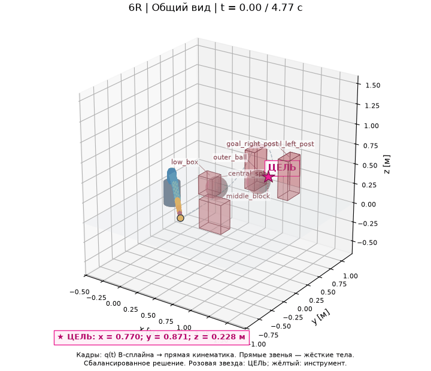
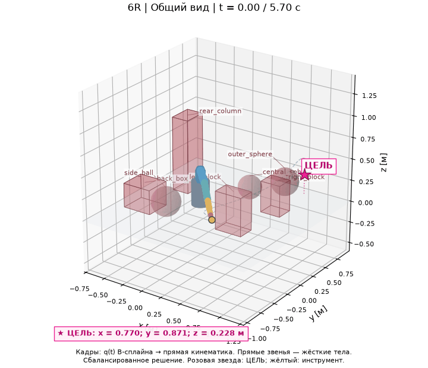
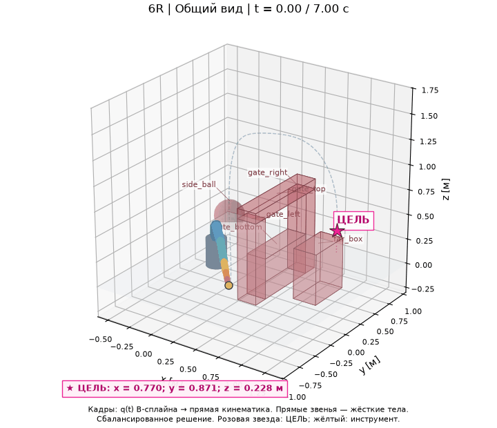
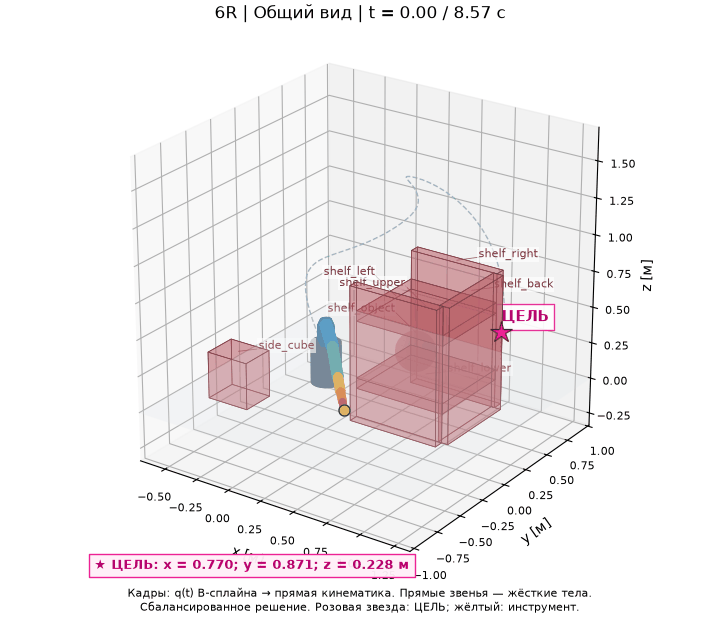
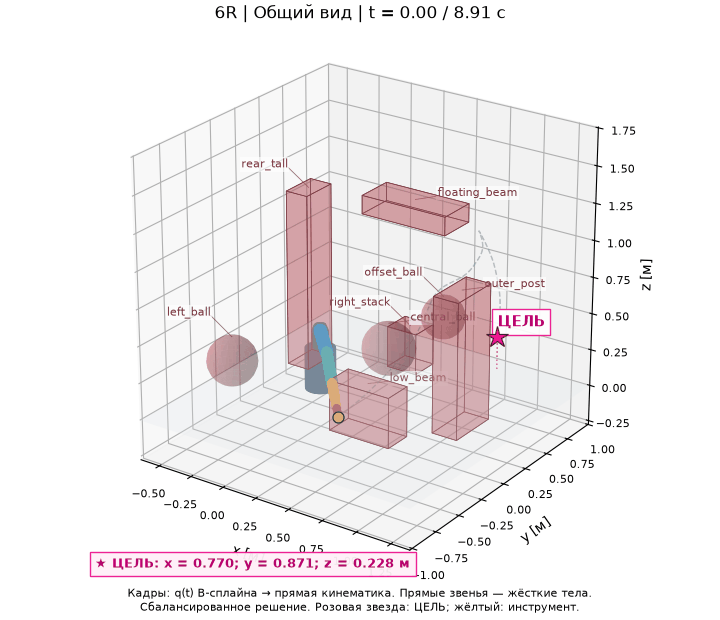
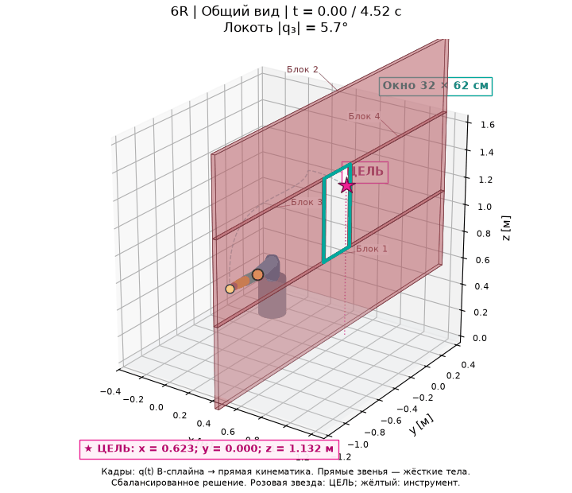

# Планирование движения пространственного манипулятора 6R

Исследовательский проект многокритериального планирования движения шестисуставного
манипулятора в 3D-сценах с препятствиями. Пайплайн **RRT* → B-сплайны → NSGA-II**
строит допустимую траекторию и находит компромиссы между временем движения,
суставными усилиями и плавностью.

## Демонстрация

Сбалансированная траектория после NSGA-II: движение к цели между препятствиями.



<details>
<summary>Анимации остальных сцен</summary>

### Разрозненные препятствия



### Рама с окном



### Стеллаж



### Препятствия на разных высотах



### Узкий проём со складыванием локтя



</details>

## Установка и запуск

Требуются **Python 3.14**, **uv** и **just**. Модель и динамика реализованы
на MuJoCo, оптимизация — на pymoo, визуализация — на Matplotlib и Plotly.

```powershell
just sync
just quick
just demo
```

`quick` запускает полный пайплайн с уменьшенным бюджетом. `demo` сохраняет
результаты в `results/demo/`; откройте `view.html` для просмотра.

Запуск другой сцены и настройка бюджета:

```powershell
just demo gate results/gate
uv run manipulator-planning demo --scene shelves --seed 42 --iterations 800 --population 32 --generations 24 --output results/shelves
```

## Метод

1. **RRT*** ищет путь в пространстве шести суставных углов с проверкой столкновений.
2. **B-сплайн пятой степени** задаёт плавное движение с нулевыми скоростями
   и ускорениями в начале и конце.
3. **NSGA-II** оптимизирует коэффициенты сплайна и длительность движения
   по трём критериям:

| Критерий | Определение | Единицы |
| --- | --- | --- |
| Время `T` | Длительность движения | с |
| Усилия `J_tau` | Интеграл квадратов суставных моментов | (Н·м)²·с |
| Рывок `J_jerk` | Интеграл квадрата третьей производной суставных углов | рад²/с⁵ |

Из найденного фронта выбираются четыре варианта: **минимум времени, минимум
усилий, минимум рывка и сбалансированный**. Минимум рывка соответствует
максимальной плавности. Сбалансированный вариант выбирается по нормированному
расстоянию до идеальной точки с равными весами критериев.

Проверяются столкновения звеньев с препятствиями и между собой, пределы углов,
скоростей, ускорений и моментов. Моменты проверяются на 301 временном отсчёте.
Модель учебная, фронт Парето — приближённый; анимация воспроизводит сохранённый
B-сплайн средствами прямой кинематики.

## Сцены

| Сцена | Препятствий | Описание |
| --- | ---: | --- |
| `simple` | 6 | Центральная группа объектов и цель между стойками |
| `scattered` | 7 | Сферы и блоки разного размера |
| `gate` | 6 | Рама с окном и дополнительными объектами |
| `shelves` | 7 | Стеллаж с полками и предметами |
| `cluttered` | 8 | Объекты на разных высотах и верхняя балка |
| `narrow_passage` | 4 | Сплошная стена с узким окном: проход со складыванием локтя |

Настройки сцен находятся в `configs/`, модель манипулятора —
в `src/manipulator_planning/assets/educational_6r.xml`.

## Эксперименты и галерея

```powershell
just experiments
just showcase results/experiments
just serve
```

Серия по умолчанию содержит пять сцен и 20 seed: **100 пар запусков**.
Сравниваются RRT* → B-сплайн и полный пайплайн с NSGA-II. В каждой паре
используются одинаковые исходные путь и сплайн. Сохраняются успешность,
критерии, время расчёта, гиперобъём и парные изменения с доверительными интервалами.
Сохранённая сводка включает все шесть сцен и 20 seed: **120 пар запусков**.
Общий [отчёт](docs/experiments/REPORT.md), CSV, JSON и сведения о происхождении
результатов находятся в `docs/experiments/`; настройки указаны для каждой сцены.

Галерея: **[открыть showcase](https://artemzs.github.io/manipulator-motion-planning/showcase/index.html)**.
Для каждой сцены доступны
анимации с двух ракурсов, вращаемый 3D-вид, четыре цветные траектории,
таблица параметров и графики Парето. Четыре варианта отмечены на траекториях
и графиках одинаковыми цветами; совпадающие решения указаны явно.

Вращение сцены — левой кнопкой мыши, масштаб — колесом, сдвиг — правой кнопкой.
Розовый маркер обозначает цель, жёлтый — текущий инструмент, зелёный — старт.

Публичная галерея размещена на GitHub Pages и работает без установки проекта.
Команды `just showcase`, `just showcase-add` и `just showcase-statistics` автоматически
сохраняют входы для Pages после успешного обновления галереи. Остаётся закоммитить
результаты и сделать push в основную ветку: GitHub Actions пересоберёт и опубликует сайт.
Подробности — в [описании публикации](docs/GITHUB_PAGES_RU.md).

Повторная проверка сохранённых траекторий и экспорт дополнительных ракурсов:

```powershell
just replay results/demo
just views results/demo
```

## Выходные файлы

| Файл | Содержимое |
| --- | --- |
| `view.html`, `interactive.html` | Отчёт и вращаемая 3D-сцена |
| `animation_*.gif`, `scene_*.png` | Анимации и изображения с разных ракурсов |
| `comparison.png`, `pareto.png` | Сравнение путей и фронт Парето |
| `variants.csv`, `variants.json` | Параметры четырёх выбранных вариантов |
| `joints.png` | Углы, скорости, ускорения, рывки и моменты |
| `report.json`, `config.yaml` | Проверки, параметры запуска и сцена |
| `trajectories.json`, `trajectories.npz` | Сплайны, отсчёты и путь RRT* |

## Проверки

```powershell
just test
just check
just build
```
