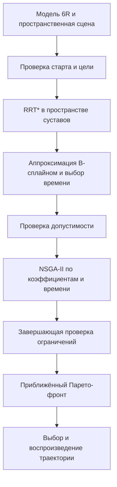

# План реализации многокритериальной оптимизации пространственного манипулятора

Дата разбора: 15 октября 2026 года.

Цель проекта — реализовать каскад RRT* → B-сплайны → NSGA-II для пространственного манипулятора, согласовать программную реализацию с теоретической частью ВКР и подготовить воспроизводимые вычислительные эксперименты по плану задания.

Пользователь выбрал учебную модель с шестью вращательными суставами. Этот документ сохраняет первоначальный план, составленный до начала программной реализации. Текущее состояние проекта и команды запуска описаны в [README](../README.md). При реализации зафиксирован Python 3.14, а предложенный ниже PyBullet заменён на совместимый MuJoCo; модель хранится в MJCF.

## 1 Изученные материалы и границы разбора

| Материал | Что проверено |
| --- | --- |
| [План задание](<C:/Users/tyuu5/Desktop/mai/Диплом мага с гпт/План задание Зеленый М8О-109СВ-25.docx>) | Тема, цель, перечень задач, этапы 3D-моделирования, экспериментов и анализа |
| [Теоретическая часть](<C:/Users/tyuu5/Desktop/mai/Диплом мага с гпт/Теор часть Зеленый.pdf>) | Все 9 страниц, формулы критериев, ограничения, архитектура и формулировки гарантий |
| [PDF презентация](<C:/Users/tyuu5/Desktop/mai/Диплом мага с гпт/Проект/Презентация_Зеленый.pdf>) | Все 14 страниц по содержанию, отдельно изображения результатов на страницах 6, 9, 12 и 13 |
| [Ноутбук 2D реализации](<C:/Users/tyuu5/Desktop/mai/Диплом мага с гпт/Проект/2d реализация (пока что лучшая).ipynb>) | Все 56 ячеек, определения классов и функций, сохранённые результаты демонстрации |
| [Презентация 2d манипулятор](<C:/Users/tyuu5/Desktop/mai/Диплом мага с гпт/Проект/2d манипулятор.pptx>) | Файл имеет размер 0 байт и не содержит доступных слайдов |

Разбор кода выполнен статически, а четыре локальных дефекта дополнительно воспроизведены отдельными вызовами исходных классов. Полный ноутбук заново не запускался. Сохранённые в нём численные результаты не являются новым экспериментом. Исходные материалы не изменялись.

## 2 Что уже реализовано

В ноутбуке построен прототип движения точки на плоскости. `Point`, `CircleObstacle` и `RectangleObstacle` задают геометрию. `RRTStar2D` ищет дискретный путь. `smooth_path_with_bspline` строит интерполяционную кривую через переданные точки. `NSGAII` изменяет массив этих точек. `IntegratedPathOptimizer` запускает этапы и визуализирует результаты.

Сохранённый демонстрационный запуск сообщает о 14 препятствиях, пути из 38 точек и 30 недоминируемых решениях после оптимизации с популяцией 30 и 30 поколениями. Это полезная демонстрация работоспособности идеи, но её недостаточно для статистических выводов о качестве метода.

Основное, что можно сохранить: каскад методов, логику построения дерева и эволюционного отбора, идею инициализации от найденного пути, выбор крайних и компромиссного решений, сценарии визуализации. Геометрию, представление траектории, целевые функции и обработку ограничений потребуется переработать.

## 3 Расхождения между теорией и прототипом

| Аспект | Текущее состояние | Требуемое решение |
| --- | --- | --- |
| Состояние объекта | Координаты точки `(x, y)` | Вектор углов `q = (q1, …, q6)` |
| Манипулятор | Звенья отсутствуют | Последовательная цепь, геометрия и инерционные параметры |
| Столкновения | Точка против кругов и прямоугольников | Все звенья против пространственных препятствий, основания и друг друга |
| Первый критерий | Ускорения точки плюс штраф за отклонение от пути RRT* | Интеграл квадратов суставных моментов из теории |
| Второй критерий | Квадрат кривизны плоской кривой | Интеграл квадрата суставного рывка |
| Третий критерий | Длина кривой при условной постоянной скорости | Оптимизируемая длительность движения в секундах |
| B-сплайн | Точки интерполяции называются контрольными | Явные коэффициенты B-сплайна в суставном пространстве |
| Передача между этапами | NSGA-II получает `rrt_path`, отдельный `smoothed_path` используется для демонстрации | NSGA-II получает параметры проверенной сплайновой траектории |
| Сохранение результатов | Преимущественно вывод в ноутбуке | Конфигурации, коэффициенты, ограничения, метрики и история эксперимента |

Важное терминологическое уточнение: `∫τᵀτ dt` из теории — критерий затрат управляющих усилий, часто используемый как энергетический суррогат. Его единицы — `(Н·м)²·с`, а не джоули. Сохраним именно требуемый критерий и корректно подпишем его. Для оценки физической энергии понадобилась бы отдельная модель мощности и потерь приводов.

### 3.1 Дефекты исходного кода

Нумерация ячеек ниже начинается с нуля и относится к исходному IPYNB.

1. **Цель не включается в результат RRT*.** В ячейке 16 сохраняется `goal_node = new_node`, а `_extract_path` возвращает цепочку до этого узла. В контрольном примере со стартом `[0, 0]`, целью `[1, 0]`, шагом `0.4` и выборкой цели на каждой итерации путь закончился в `[0.8, 0]`. Новый планировщик должен включать проверенное последнее ребро и точную целевую конфигурацию.
2. **Планировщик останавливается после первого подключения к цели.** Такая остановка ограничивает эффект последующего улучшения RRT*. Предусмотрим отдельные режимы поиска первого решения и улучшения до исчерпания бюджета.
3. **Переподключение не обновляет стоимости потомков.** В `_rewire` меняется стоимость только переподключённого узла. При проверке его стоимость снизилась с 10 до 2, а стоимость потомка осталась 11 вместо 3. Нужны списки потомков и распространение изменений.
4. **Неудача поиска недостаточно явно выражена.** При отсутствии пути возвращается один стартовый узел, после чего интегрирующий код всё равно печатает сообщение об успешном поиске. Введём статус, причину завершения и отдельное отсутствие результата.
5. **Генерируемая и показываемая траектории различаются.** Оценка NSGA-II вызывает сглаживание с коррекцией столкновений, а ряд графиков повторно интерполирует точки без этой коррекции. Оценщик, валидатор и визуализатор должны использовать один объект траектории.
6. **Шкала времени несогласованна.** `_compute_energy` в ячейке 41 вычисляет `gradient` без временного шага, затем интегрирует с `dx=0.1`; длительность отдельно получается из длины. Изменение числа отсчётов меняет величину критерия. В 3D все производные будут вычисляться аналитически по одному закону времени.
7. **Критерий энергии смешан с отклонением от RRT*.** В `_evaluate` добавляется `path_deviation_weight * deviation`. Такое смешение меняет смысл первого критерия. Привязку к исходному пути оставим только как явную настройку поиска и инициализации.
8. **Сплайновая коррекция не подтверждает безопасность всего движения.** Проверяются отдельные отсчёты. После повторной интерполяции в функции сглаживания нет завершающей проверки всех интервалов. Проверка контрольных точек также не доказывает безопасность кривой.
9. **Вспомогательные реализации содержат отдельные ошибки.** `RectangleObstacle.get_penalty` возвращает ноль внутри прямоугольника. Собственный `BSplineCurve` в ячейке 25 возвращает `[0, 0]` на правом конце вместо последней точки; основной каскад при этом пользуется другой функцией сплайнов. Это подтверждено отдельными вызовами.
10. **Одного `seed` недостаточно для воспроизводимости текущей демонстрации.** Число препятствий выбирается до установки seed внутри `RandomEnvironment`. В проекте будут отдельные генераторы и seed для сцены, планировщика и оптимизатора.

Эти замечания задают требования к новой реализации. Переписывание исходного ноутбука целиком не является отдельным обязательным этапом.

## 4 Математическая постановка для выбранного манипулятора

### 4.1 Модель

Основная модель — стационарный учебный манипулятор 6R: основание, плечо, локоть и три вращения запястья. Конкретные оси и смещения зафиксируем в таблице параметров и URDF. Параметры модели будут предложенными учебными значениями, с явным указанием их происхождения.

Для каждого звена зададим геометрию столкновений, массу, центр масс и положительно определённый тензор инерции. Для каждого сустава — ось, положение, пределы угла, скорости, ускорения и момента. Размерности: метры, килограммы, секунды, радианы, Н·м. Гравитация направлена по отрицательной оси Z.

Для всех шести суставов сначала используем конечные диапазоны углов. Интерполяция не должна автоматически перескакивать через границы диапазона как через периодическую координату. Поддержку непрерывных вращательных суставов можно добавить отдельным типом конфигурационного пространства.

Пространственная модель не означает трёхмерное пространство поиска. Геометрия находится в `R³`, а конфигурация шестисуставного манипулятора задаётся в шестимерном пространстве.

Начальный интерфейс сценария принимает `q_start` и `q_goal`. Затем добавим задание целевого положения и ориентации инструмента, поиск допустимых решений обратной кинематики и выбор конфигурации цели. Для недостижимой цели предусмотрим явный отказ. Ориентацию будем задавать матрицей или кватернионом.

### 4.2 Траектория и оптимизируемые переменные

Введём нормированный параметр `u ∈ [0, 1]` и положительную длительность `T`:

```text
q(t) = Σ B_i,p(t/T) P_i
P_i ∈ R⁶
x = [свободные коэффициенты P, T]
```

Коэффициенты образуют массив `K × 6`. Основной вариант — зажатый B-сплайн пятой степени с простыми внутренними узлами. Он обеспечивает непрерывный рывок внутри интервала при такой структуре узлов. Кубический вариант сохраним как сравнение: при простых внутренних узлах он имеет C²-гладкость, а рывок может иметь скачки.

Первые и последние коэффициенты ограничим так, чтобы выполнялись:

```text
q(0) = q_start             q(T) = q_goal
q_dot(0) = 0              q_dot(T) = 0
q_ddot(0) = 0             q_ddot(T) = 0
```

Для зажатого сплайна нулевые граничные скорость и ускорение можно обеспечить совпадением первых трёх коэффициентов со стартом и последних трёх с целью. При `K=12` останется `6 × (12−6) + 1 = 37` переменных вместе с T. Значение K будет настраиваемым: при недостаточной гибкости кривой число коэффициентов увеличивается.

Все производные вычисляются из представления сплайна:

```text
q_dot(t)   = q_u'(u) / T
q_ddot(t)  = q_u''(u) / T²
q_dddot(t) = q_u'''(u) / T³
```

### 4.3 Критерии

Основная задача соответствует страницам 6–8 теоретического материала:

```text
min F(x) = [J_tau(x), J_jerk(x), T]

J_tau  = ∫₀ᵀ τ(t)ᵀ τ(t) dt
J_jerk = ∫₀ᵀ ||q_dddot(t)||² dt

τ = M(q) q_ddot + C(q, q_dot) q_dot + G(q)
```

Практически моменты вычислим алгоритмом обратной динамики, без ручной сборки всех элементов C. Численное интегрирование выполним по участкам между узлами сплайна с проверкой точности. Для фиксированной формы кривой критерий рывка масштабируется как `T⁻⁵`, что даёт полезную контрольную зависимость.

Длину траектории инструмента, длину пути в суставном пространстве и пространственную кривизну можно сохранять как дополнительные показатели. Они не подменяют три основных критерия.

### 4.4 Ограничения

Для всей траектории необходимо учитывать:

- границы углов суставов;
- пределы суставных скоростей и ускорений;
- пределы моментов;
- расстояние от каждого звена до препятствий не меньше `d_safe`;
- отсутствие недопустимых столкновений звеньев между собой, с основанием и рабочим столом;
- точные граничные условия и `T_min ≤ T ≤ T_max`.

Соседние звенья могут иметь предусмотренные конструкцией пересечения возле шарнира. Такие пары исключаются только по явной таблице допустимых контактов, проверенной для выбранной геометрии. Остальные пары сохраняются в проверке.

## 5 Как адаптировать каскад методов



### 5.1 Общая геометрия и проверка движения

Создадим один `RobotModel` и один `CollisionChecker`, используемые всеми этапами. Прямая кинематика преобразует конфигурацию q в положения всех звеньев. Геометрия столкновений будет состоять из простых объёмных примитивов; сложные визуальные модели не нужны для первого результата.

Препятствия первого набора — сферы, параллелепипеды и цилиндры. Сцена также содержит основание, пол или стол. Все проверяемые расстояния относятся к поверхностям объёмных звеньев, а не к координатам суставов.

Для конфигурации проверяется вся геометрия. Для ребра RRT* и участка сплайна требуется проверять движение между конфигурациями. Фиксированная редкая сетка может пропустить столкновение. Поэтому начнём с адаптивного разбиения, а для приёмки траекторий добавим консервативные оценки максимального смещения геометрии звеньев на интервале.

Принцип интервальной проверки: расстояние в контрольной конфигурации сравнивается с безопасным зазором и верхней оценкой возможного перемещения звеньев до любой конфигурации интервала. Если этой оценки недостаточно, интервал делится. Для самостолкновений учитываются перемещения обоих звеньев. Неопределённый после достижения лимита интервал не помечается безопасным. Численные допуски геометрического движка фиксируются отдельно.

Для динамических ограничений сначала предусмотрим сгущаемую сетку и проверку устойчивости результатов. Формальную непрерывную гарантию по моментам при такой проверке заявлять нельзя. Пределы углов и производных можно дополнительно проверять через свойства коэффициентов сплайна и поиск экстремумов его полиномиальных участков.

### 5.2 RRT* в шестимерном пространстве

Планировщик будет принимать абстракцию конфигурационного пространства: `sample`, `distance`, `interpolate`, `is_valid`, `is_motion_valid`. Это уберёт привязку к x/y.

Расстояние зададим как норму нормированных суставных смещений. Правило соседства должно учитывать размерность пространства. Для начального варианта можно использовать классическую форму `r_N = min(η, γ(log N / N)^(1/d))`, где `d=6`; константы относятся к выбранной нормированной метрике. Правило и его связь с теоретическими условиями вынесем в описание метода, а не перенесём двумерную степень `0.5` из прототипа. При обсуждении строгих доказательств учтём опубликованные уточнения к анализу RRT*.

Исправим включение цели, обновление стоимости потомков и обработку неуспеха. После первого решения алгоритм продолжает улучшение до заданного бюджета, сохраняя лучший найденный путь. Стоимость пути обязательно включает финальное ребро к цели.

Сначала допустим линейный поиск соседей для прозрачной отладки. Пространственный индекс добавим после измерения затрат. Отдельно сохраним несколько путей, полученных при разных seed: один исходный путь может ограничить разнообразие последующей оптимизации.

### 5.3 Переход от пути к допустимому сплайну

Найденный путь переразобьём по длине в выбранной суставной метрике, затем найдём коэффициенты B-сплайна аппроксимацией с граничными условиями. Не будем выдавать узлы интерполяции за коэффициенты базиса.

После аппроксимации повторно проверим ограничения. Если сглаживание пересекло препятствие, последовательно увеличим число коэффициентов, добавим локальные условия приближения к проверенному пути либо возьмём другой путь. Безопасность ломаной не переносится автоматически на сглаженную кривую. При невозможности построить допустимый сплайн этап завершится явным статусом.

Начальное T выберем из требований к скоростям и ускорениям, затем проверим моменты с учётом гравитации. Увеличение T не является универсальным способом исправить превышение момента: статическая нагрузка может остаться недопустимой. Область времени ограничим и будем искать допустимую пару формы и длительности.

Результатом этапа станет объект `JointSplineTrajectory`: коэффициенты, узлы, степень, время, производные и протокол проверки. Именно он передаётся в оптимизатор.

### 5.4 NSGA-II

Генотип состоит из свободных коэффициентов и T. Популяция инициализируется проверенными сплайнами с локальными вариациями и несколькими вариантами времени. При наличии нескольких исходных путей они участвуют в инициализации.

Сохраняются сортировка по недоминированию, crowding distance, турнирный отбор, SBX и полиномиальная мутация. Для основной реализации предлагается pymoo, чтобы сосредоточить собственный код на модели траектории, критериях и ограничениях. Исходная реализация NSGA-II остаётся материалом для объяснения метода и проверки поведения на небольших задачах.

Ограничения передаются отдельно от F. Допустимые решения имеют приоритет перед недопустимыми; среди недопустимых учитывается нормированная величина нарушения. Коэффициенты, фиксирующие границы, не участвуют в свободной мутации. Простое ограничение диапазонов коэффициентов не заменяет проверку столкновений и динамики.

Сохраняется внешний архив недоминируемых кандидатов. Перед выдачей результата кандидаты повторно проверяются с более строгими настройками. После удаления не прошедших проверку решений фронт пересчитывается. Дубликаты учитываются отдельно от числа различных траекторий.

Название результата — приближённый Парето-фронт найденных допустимых траекторий. Конечный запуск NSGA-II не доказывает глобальную оптимальность. При небольшом бюджете фронт может содержать мало решений или отсутствовать.

### 5.5 Выбор и показ решения

Пользователь получает варианты с минимальными J_tau, J_jerk и T, а также компромиссный вариант по явно описанному правилу нормировки. Выбор компромисса не меняет саму многокритериальную задачу.

Для выбранного решения показываются объёмный манипулятор, препятствия, движение звеньев и путь инструмента. Графики содержат углы, скорости, ускорения, рывки, моменты, расстояния и их пределы. Парето-фронт отображается в пространстве трёх критериев и в попарных проекциях. Визуализация использует тот же объект траектории, который оценивался и проверялся.

## 6 Предлагаемый программный стек

| Компонент | Выбор и назначение |
| --- | --- |
| Язык | Python; совместимую версию и версии зависимостей зафиксируем после проверки установки на Windows |
| Вычисления | NumPy и SciPy, B-сплайны и их производные, численное интегрирование |
| Модель и геометрия | URDF и PyBullet: кинематика, обратная динамика, запросы столкновений и воспроизведение |
| Оптимизация | pymoo с NSGA-II, SBX, полиномиальной мутацией и отдельными ограничениями |
| Графики | Matplotlib для материалов ВКР, Plotly для интерактивного просмотра фронта при необходимости |
| Настройки | YAML для сцен и экспериментов |
| Результаты | JSON для метаданных, NPZ для массивов траекторий, CSV для сводных таблиц |
| Проверки | pytest для кинематики, динамики, планирования, производных и соблюдения ограничений |

Один URDF служит общим источником геометрии и инерционных параметров. В режиме экспериментов визуальное окно не требуется. Динамическое воспроизведение можно использовать как дополнительную проверку согласованности, но анимация через установку суставов сама по себе не подтверждает выполнение движения приводами.

## 7 Предлагаемая структура проекта

Ниже показана будущая структура. Эти модули пока не созданы.

```text
diplom/
  pyproject.toml
  README.md
  configs/
    robots/
    scenes/
    experiments/
  assets/robots/educational_6r/
  src/manipulator_planning/
    models/          # RobotModel, кинематика и обратная динамика
    geometry/        # Scene, препятствия и CollisionChecker
    planning/        # Конфигурационное пространство и RRT*
    trajectories/    # B-сплайн, производные и параметризация времени
    objectives/      # J_tau, J_jerk, ограничения и интегрирование
    optimization/    # Задача pymoo и NSGA-II
    validation/      # Проверка интервалов и итоговых кандидатов
    visualization/   # Движение, графики и фронты
    experiments/     # Запуски, статистика и сравнения
    pipeline.py
    cli.py
  notebooks/         # Демонстрации и исследовательский анализ
  tests/
  results/
  docs/
```

Основные передаваемые данные: `RobotModel`, `Scene`, `JointPath`, `JointSplineTrajectory`, `EvaluationResult`, `ValidationReport`, `ParetoArchive`. У каждой траектории есть идентификатор и сохранённые параметры, чтобы численные значения можно было связать с её графиками и повторно воспроизвести.

## 8 Порядок реализации и признаки готовности

| Этап | Работа | Проверяемый результат |
| --- | --- | --- |
| 1 | Формализовать параметры 6R и контракт критериев | Таблица параметров, URDF, единицы измерения, перечень ограничений |
| 2 | Собрать кинематику, динамику и сцену | Положения звеньев и моменты проверены на простых конфигурациях, столкновения диагностируются по парам |
| 3 | Реализовать конфигурационное пространство и RRT* | На простой сцене найден проверенный путь между точными q_start и q_goal, неуспех выражен статусом |
| 4 | Построить суставный B-сплайн с T | Граничные условия и производные соблюдены, сглаженная траектория проверена |
| 5 | Подключить критерии и NSGA-II | Получен архив допустимых недоминируемых решений с различающимися T и формой движения |
| 6 | Сделать единый демонстрационный запуск | Сцена, анимация, фронт, графики суставов и сохранение результата |
| 7 | Провести пилотные измерения | Выбраны бюджеты поиска и оптимизации, проверены скорость работы и настройки точности |
| 8 | Провести серии экспериментов | Сводные таблицы, распределения, фронты, сравнение и анализ сложности |

Первый вертикальный результат: учебный 6R, одна простая сцена, полный каскад и воспроизведение выбранного решения. При необходимости отдельные формулы кинематики и геометрии можно проверить на сокращённой цепи, но конечный результат первого цикла разработки относится к выбранным шести суставам.

Далее добавляются сложные сцены, несколько инициализирующих путей и пакетные эксперименты. Оптимизация производительности следует после профилирования: кэширование базиса, расчёт производных массивами, отсечение заведомо недопустимых кандидатов до дорогой динамики. Параллельные вычисления, если понадобятся позднее, потребуют отдельного состояния геометрического движка для каждого процесса.

## 9 Вычислительные эксперименты

### 9.1 Сценарии

1. Пустая сцена для проверки модели и временной параметризации.
2. Одиночное препятствие на прямом движении.
3. Несколько препятствий с альтернативными обходами.
4. Узкий проход, где важны размеры звеньев и безопасный зазор.
5. Случай, в котором инструмент проходит свободно, а промежуточное звено сталкивается с препятствием.
6. Риск самостолкновения и близость к основанию.
7. Условия возле пределов суставов и моментов.
8. Несколько плотностей случайных препятствий с фиксированными seed.
9. Недопустимые старт или цель, а также задача без найденного допустимого пути в пределах бюджета.

### 9.2 Сравнения

- RRT* с допустимой параметризацией времени и сглаживанием как исходный вариант без многокритериального улучшения.
- Полный каскад с NSGA-II.
- Три однокритериальных варианта по тем же J_tau, J_jerk и T.
- Взвешенная сумма критериев с несколькими фиксированными весами.
- Влияние степени сплайна, числа коэффициентов, времени движения и числа исходных путей.
- Для пункта задания о сравнении с литературой — выбрать один воспроизводимый опубликованный аналог после проверки доступности реализации и совпадения постановки. Внутренние варианты выше не заменяют такой аналог. Результаты чужих работ с другими роботами нельзя напрямую сравнивать по абсолютным значениям критериев.

Для сравнения оптимизаторов фиксируется бюджет оценок и отдельно учитывается фактическое время. Для сравнения полных каскадов учитываются и затраты планирования, и затраты оптимизации. Показатели исходного и улучшенного вариантов вычисляются одним оценщиком.

### 9.3 Метрики и статистика

Сохраняются успешность этапов, доля допустимых кандидатов, J_tau, J_jerk, T, минимальные зазоры, максимальные нарушения ограничений, число различных решений, время работы и количество геометрических и динамических вычислений.

Качество фронтов оценивается гиперобъёмом с одинаковой нормировкой и фиксированной опорной точкой для сравниваемых методов на одной задаче. IGD+ используется только при наличии обоснованного эталонного множества; объединение найденных фронтов можно применять как эмпирический ориентир с соответствующей оговоркой.

Для итоговых сравнений ориентир — 20–30 независимых запусков на сценарий после пилотной оценки стоимости. Фиксируется список seed. Там, где сцены случайные, отдельно учитывается вариативность сцен и алгоритмов. Приводятся медианы, межквартильные интервалы, доверительные интервалы и доля неуспешных запусков. Одинаковые сцены позволяют проводить парные сравнения. Окончательное число повторов определяется доступным бюджетом и устойчивостью оценок.

В оценке сложности разделяются поиск соседей, проверки столкновений, оценка одной траектории, динамика и сортировка NSGA-II. Для популяции S, поколений G, числа отсчётов H и стоимости одной проверки C_eval полезна схема `O(G × (3S² + S × C_eval))`, где C_eval зависит от H, геометрии и робота. Число RRT-узлов и число коэффициентов сплайна обозначаются отдельными переменными. Заявлять универсальное `O(N log N)` для любого собственного кода и любой геометрии нельзя.

## 10 Проверка корректности

Обязательные проверки должны выявлять физические и алгоритмические ошибки:

- сравнение прямой кинематики с независимо рассчитанными опорными конфигурациями;
- правильные оси, знаки гравитации и моменты удержания в статике;
- симметрия и положительная определённость матрицы инерции в выбранных конфигурациях;
- согласованность обратной динамики и ускорения в коротком прямом моделировании с согласованными параметрами трения и демпфирования;
- совпадение начальной и конечной конфигураций, нулевые граничные скорость и ускорение;
- проверка аналитических производных сплайна и закона масштабирования J_jerk по T;
- устойчивость интегралов при ужесточении квадратуры;
- сцены с заранее известными столкновениями, в том числе между отсчётами;
- корректное обновление потомков при rewiring и правильная стоимость финального ребра;
- проверка недоминирования архива и исключение недопустимых решений;
- совпадение параметров оцениваемой, сохранённой и показанной траектории;
- воспроизводимость по сохранённой конфигурации и seed.

Повторное воспроизведение конечного результата проводится из сохранённых параметров, без повторного запуска оптимизации.

## 11 Соответствие заданию и пределы утверждений

Задание требует разработки метода, 3D-модели, серии экспериментов, анализа Парето-фронтов, оценки вычислительной сложности и сравнения с аналогами. Поэтому готовность проекта определяется воспроизводимыми результатами, а не только наличием анимации.

На 15 октября 2026 года срок этапа 5 в исходном задании уже прошёл, а этап 6 запланирован на октябрь–ноябрь 2026 года. Фактическую работу следует выстроить как завершение 3D-реализации, затем пилотные и основные эксперименты. Исходный календарный план не изменяется этим документом. Анализ фронтов и сложности соответствует этапу 7, декабрь 2026 — 15 января 2027 года. Срок сдачи завершённой работы в задании — 2 июня 2027 года.

В теоретическом тексте стоит уточнить следующие утверждения при подготовке окончательной редакции:

- конечный запуск RRT* может не найти путь, даже если он существует;
- асимптотические свойства относятся к алгоритму при определённых предпосылках и не доказывают оптимальность найденной конечной траектории;
- безопасность пути после RRT* не гарантирует безопасность B-сплайна и результатов мутации;
- выпуклая оболочка коэффициентов помогает с выпуклыми ограничениями, но свободная от столкновений область суставов обычно невыпукла;
- конечный запуск NSGA-II возвращает приближение фронта, а не сертификат глобальной Парето-оптимальности;
- свойства C² или C⁴ относятся к определённой степени и кратности узлов;
- проверка на дискретной сетке должна сопровождаться указанием её точности и ограничений.

## 12 Источники для технических решений

Собственные наблюдения о прототипе основаны на перечисленных локальных материалах. Возможности предлагаемых библиотек и оговорки к теории сверены с первичными источниками:

1. [Karaman и Frazzoli, Sampling-based Algorithms for Optimal Motion Planning](https://arxiv.org/abs/1105.1186) — исходная работа о RRT* и условиях его анализа.
2. [Solovey и соавторы, Revisiting the Asymptotic Optimality of RRT*](https://arxiv.org/abs/1909.09688) — уточнения к доказательству асимптотической оптимальности.
3. [SciPy BSpline](https://docs.scipy.org/doc/scipy/reference/generated/scipy.interpolate.BSpline.html) — явные коэффициенты B-сплайна и получение производных.
4. [SciPy make_lsq_spline](https://docs.scipy.org/doc/scipy/reference/generated/scipy.interpolate.make_lsq_spline.html) — аппроксимация в B-сплайновом базисе. Граничные ограничения потребуют отдельного учёта в задаче подбора коэффициентов.
5. [Документация pymoo NSGA-II](https://pymoo.org/algorithms/moo/nsga2.html) — реализация отбора и генетических операторов.
6. [Документация pymoo Feasibility First](https://pymoo.org/constraints/feas_first.html) — раздельная обработка критериев и нарушений ограничений.
7. [PyBullet Quickstart Guide в официальном репозитории](https://github.com/bulletphysics/bullet3/blob/master/docs/pybullet_quickstart_guide/PyBulletQuickstartGuide.md.html) — загрузка моделей, кинематика, динамика, запросы геометрии и режимы GUI/DIRECT.
