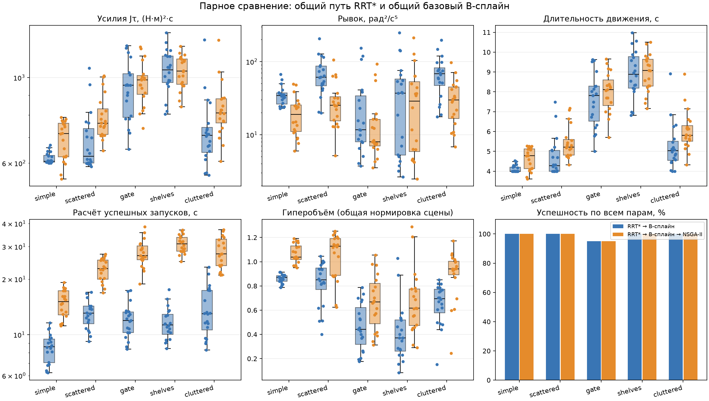

# Парные эксперименты пространственного манипулятора 6R

Оба метода используют один и тот же путь RRT* и один базовый B-сплайн для каждой пары (сцена, seed). NSGA-II добавляется после получения допустимой базы. Время расчёта включает планирование, сглаживание и, для полного метода, оптимизацию с проверкой. Рендеринг и запись файлов исключены.

| Сцена | Метод | Успех | Jτ, медиана | Рывок, медиана | T, с | Расчёт, с | HV |
|---|---|---:|---:|---:|---:|---:|---:|
| simple | RRT* → B-сплайн | 20/20 | 606 | 34.3 | 4 | 8.6 | 0.869 |
| simple | RRT* → B-сплайн → NSGA-II | 20/20 | 716 | 18.9 | 4.78 | 15.1 | 1.04 |
| scattered | RRT* → B-сплайн | 20/20 | 625 | 60.9 | 4.27 | 13.1 | 0.85 |
| scattered | RRT* → B-сплайн → NSGA-II | 20/20 | 762 | 25.3 | 5.21 | 22.8 | 1.13 |
| gate | RRT* → B-сплайн | 19/20 | 955 | 11.7 | 7.82 | 12 | 0.442 |
| gate | RRT* → B-сплайн → NSGA-II | 19/20 | 985 | 7.95 | 8.11 | 26.8 | 0.667 |
| shelves | RRT* → B-сплайн | 20/20 | 1.05e+03 | 37 | 8.88 | 11.3 | 0.37 |
| shelves | RRT* → B-сплайн → NSGA-II | 20/20 | 1.04e+03 | 28.8 | 9.07 | 31.1 | 0.616 |
| cluttered | RRT* → B-сплайн | 20/20 | 709 | 68.3 | 5.03 | 13 | 0.696 |
| cluttered | RRT* → B-сплайн → NSGA-II | 20/20 | 810 | 30 | 5.81 | 27.4 | 0.941 |

## Парные изменения выбранного компромисса

Отрицательное изменение критерия означает уменьшение. Интервал — 95% процентильный бутстреп-интервал медианы по seed. Все оценки ниже условны на успешном завершении обоих методов.

| Сцена | Пар | ΔJτ, % [95% ДИ] | Δрывка, % [95% ДИ] | ΔT, % [95% ДИ] |
|---|---:|---:|---:|---:|
| simple | 20 | 14.5 [3.35; 18.6] | -49.9 [-63.1; -28.1] | 14.7 [3.47; 19.4] |
| scattered | 20 | 17.4 [12.8; 20.7] | -60 [-65.8; -51.2] | 18.2 [13.5; 21.9] |
| gate | 19 | 3.33 [0.579; 9.96] | -22.7 [-47; -9.8] | 4.09 [1.24; 12.2] |
| shelves | 20 | 0.00219 [-2.22; 1.96] | -10.1 [-16.5; -4.8] | 0.245 [-0.323; 2.62] |
| cluttered | 20 | 15.8 [12.4; 18.3] | -58 [-62.3; -51.8] | 17.3 [13.3; 20.4] |

## Крайние решения: медианы парных изменений

Каждая строка выбирает отдельную траекторию. Улучшение одного критерия не означает одновременного улучшения остальных.

| Сцена | Выбор | ΔJτ, % | Δрывка, % | ΔT, % |
|---|---|---:|---:|---:|
| simple | Минимум усилий | -15.5 | 128 | -15.7 |
| simple | Минимум рывка | 183 | -99.6 | 188 |
| simple | Минимум времени | -15.5 | 128 | -15.8 |
| scattered | Минимум усилий | -12.4 | 92.5 | -12.5 |
| scattered | Минимум рывка | 168 | -99.4 | 173 |
| scattered | Минимум времени | -12.1 | 90.9 | -12.5 |
| gate | Минимум усилий | -11 | 68.5 | -11.2 |
| gate | Минимум рывка | 49.3 | -89.1 | 53.2 |
| gate | Минимум времени | -11 | 68.5 | -11.2 |
| shelves | Минимум усилий | -11.4 | 75.1 | -11.7 |
| shelves | Минимум рывка | 29.7 | -76.5 | 31 |
| shelves | Минимум времени | -11.3 | 80 | -11.8 |
| cluttered | Минимум усилий | -12.2 | 87.8 | -12.5 |
| cluttered | Минимум рывка | 128 | -98.6 | 134 |
| cluttered | Минимум времени | -12.2 | 87.8 | -12.5 |

## Что показывают результаты

У выбранного компромисса медианный рывок уменьшился в 5 из 5 сцен с успешными парами. Длительность и усилия нужно оценивать по отдельным столбцам: снижение рывка часто покупается их увеличением. Крайние решения показывают доступные альтернативы, а не одну универсально лучшую траекторию. Гиперобъём характеризует расширение доступного множества компромиссов; в него заранее включена проверенная база.

## Интерпретация и ограничения

- Серия использует конечные бюджеты и выбранный набор seed. Это приближённый фронт, а не доказательство глобальной Парето-оптимальности или превосходства на всех задачах.
- Доли успеха включают все запланированные запуски; причины отказов сохранены в runs.csv и отдельных отчётах. Медианы и парные изменения считаются только для доступных допустимых решений.
- Компромисс выбирается по нормированному расстоянию до идеала внутри фронта одного запуска; он может улучшить одни критерии и ухудшить другие. В summary.json отдельно приведены экстремальные решения по каждому из трёх критериев.
- Гиперобъём использует общие для всей сцены ideal/nadir и опорную точку (1.1, 1.1, 1.1). Эти границы зависят от состава серии; HV разных сцен и независимо построенных серий не сравниваются напрямую. В доступное множество полного метода включён проверенный базовый сплайн.
- Доверительный интервал не оценивается для единственного seed. При малой выборке он неустойчив. Нулевой базовый критерий исключает относительное изменение; абсолютное сохраняется.
- Моменты проверяются на временной сетке; это не непрерывная гарантия динамической допустимости. Модель учебная; Jτ характеризует квадраты моментов и не является электрической энергией.
- Время расчёта в таблице и на графике условно на успехе метода. В summary.json и summary.csv отдельно приведено runtime_all_attempts с затратами всех попыток, включая отказы с доступными измерениями.
- Возобновление использует только совпадающие хеши сцены, параметров, исходников, ресурсов версий библиотек и числа процессов. Уже зарегистрированные отказы также сохраняются; для повтора нужен resume=False.
- При параллельном запуске время измеряется под нагрузкой нескольких процессов. Стоимость подготовки пары общая; это не независимый замер ускорения двух программ на свободной машине.
- Это явное объединение сохранённых серий, а не повторное использование кеша под новым хешем. Исходные fingerprints, файлы и происхождение каждой пары сохранены в provenance.json. Перезапуск после ошибки ввода-вывода помечен отдельно. Времена восстановления измерены при иной нагрузке.
- Успешность объединённой серии относится к логическим парам (сцена, seed) после операционного повтора ошибки сохранения. Первоначальный отказ ввода-вывода остаётся в исходной серии и provenance.json; вычислительные отказы не заменяются. Число физических попыток указано в summary.json.

Подробные данные: [runs.csv](runs.csv), [summary.csv](summary.csv), [summary.json](summary.json).
