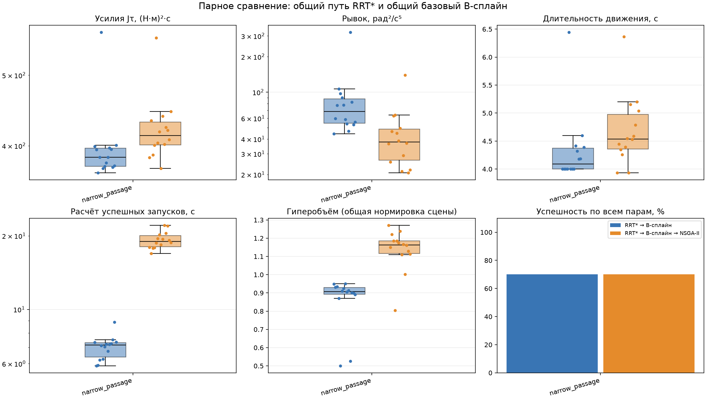

# Парные эксперименты пространственного манипулятора 6R

Оба метода используют один и тот же путь RRT* и один базовый B-сплайн для каждой пары (сцена, seed). NSGA-II добавляется после получения допустимой базы. Время расчёта включает планирование, сглаживание и, для полного метода, оптимизацию с проверкой. Рендеринг и запись файлов исключены.

| Сцена | Метод | Успех | Jτ, медиана | Рывок, медиана | T, с | Расчёт, с | HV |
|---|---|---:|---:|---:|---:|---:|---:|
| narrow_passage | RRT* → B-сплайн | 14/20 | 386 | 68.6 | 4.09 | 7.16 | 0.908 |
| narrow_passage | RRT* → B-сплайн → NSGA-II | 14/20 | 413 | 37.8 | 4.54 | 19 | 1.16 |

## Парные изменения выбранного компромисса

Отрицательное изменение критерия означает уменьшение. Интервал — 95% процентильный бутстреп-интервал медианы по seed. Все оценки ниже условны на успешном завершении обоих методов.

| Сцена | Пар | ΔJτ, % [95% ДИ] | Δрывка, % [95% ДИ] | ΔT, % [95% ДИ] |
|---|---:|---:|---:|---:|
| narrow_passage | 14 | 7.86 [1.13; 11.3] | -50.2 [-57.2; -37.8] | 9.8 [4.77; 13.7] |

## Крайние решения: медианы парных изменений

Каждая строка выбирает отдельную траекторию. Улучшение одного критерия не означает одновременного улучшения остальных.

| Сцена | Выбор | ΔJτ, % | Δрывка, % | ΔT, % |
|---|---|---:|---:|---:|
| narrow_passage | Минимум усилий | -20.7 | 162 | -19.8 |
| narrow_passage | Минимум рывка | 182 | -99.7 | 190 |
| narrow_passage | Минимум времени | -19.9 | 153 | -20.4 |

## Что показывают результаты

У выбранного компромисса медианный рывок уменьшился в 1 из 1 сцен с успешными парами. Длительность и усилия нужно оценивать по отдельным столбцам: снижение рывка часто покупается их увеличением. Крайние решения показывают доступные альтернативы, а не одну универсально лучшую траекторию. Гиперобъём характеризует расширение доступного множества компромиссов; в него заранее включена проверенная база.

## Интерпретация и ограничения

- Серия использует конечные бюджеты и выбранный набор seed. Это приближённый фронт, а не доказательство глобальной Парето-оптимальности или превосходства на всех задачах.
- Доли успеха включают все запланированные запуски; причины отказов сохранены в runs.csv и отдельных отчётах. Медианы и парные изменения считаются только для доступных допустимых решений.
- Компромисс выбирается по нормированному расстоянию до идеала внутри фронта одного запуска; он может улучшить одни критерии и ухудшить другие. В summary.json отдельно приведены экстремальные решения по каждому из трёх критериев.
- Гиперобъём использует общие для всей сцены ideal/nadir и опорную точку (1.1, 1.1, 1.1). Эти границы зависят от состава серии; HV разных сцен и независимо построенных серий не сравниваются напрямую. В доступное множество полного метода включён проверенный базовый сплайн.
- Доверительный интервал не оценивается для единственного seed. При малой выборке он неустойчив. Нулевой базовый критерий исключает относительное изменение; абсолютное сохраняется.
- Моменты проверяются на временной сетке; это не непрерывная гарантия динамической допустимости. Модель учебная; Jτ характеризует квадраты моментов и не является электрической энергией.
- Время расчёта в таблице и на графике условно на успехе метода. В summary.json и summary.csv отдельно приведено runtime_all_attempts с затратами всех попыток, включая отказы с доступными измерениями.
- Возобновление использует только совпадающие хеши сцены, параметров, исходников, ресурсов версий библиотек и числа процессов. Уже зарегистрированные отказы также сохраняются; для повтора нужен resume=False.
- При параллельном запуске время измеряется под нагрузкой нескольких процессов. Стоимость подготовки пары общая; это не независимый замер ускорения двух программ на свободной машине.

Подробные данные: [runs.csv](runs.csv), [summary.csv](summary.csv), [summary.json](summary.json).
